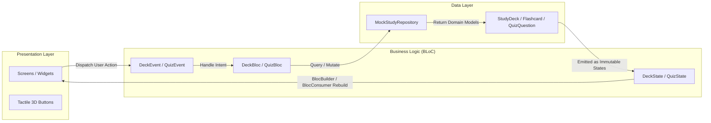

# ⚡ MindPulse — Interactive AI Study & Gamified Quiz Engine

<div align="center">

  

  <p align="center">
    <b>A high-performance, gamified document learning platform that transforms complex topics into tactile 3D flashcards and dopamine-driven quiz arenas.</b>
  </p>

  <p align="center">
    <a href="https://flutter.dev"></a>
    <a href="https://dart.dev"></a>
    <a href="https://bloclibrary.dev"></a>
    
    
  </p>

</div>

---

## 🌟 Key Highlights

- **🎮 Duolingo-Inspired Tactile UI (`Chunky3DButton`):** Physics-based push-down 3D bevel buttons with responsive spring haptics.
- **🎴 3D Perspective Flip Cards (`FlipCardWidget`):** Smooth $Y$-axis matrix transform (`Matrix4.identity()..setEntry(3, 2, 0.001)..rotateY()`) allowing interactive card flips, code snippet reveals, and mastery status toggles.
- **⚡ Gamified Quiz Arena:**
  - **Hearts / Lives Mechanism:** $3$ Hearts per session that dynamically deplete on incorrect answers.
  - **Streak Combo Multipliers:** Consecutive correct answers trigger $2\times$ and $3\times$ XP bonus multipliers.
  - **Dopamine Confetti Particle Celebration:** Full-screen celebratory particle explosions on quiz victory.
- **🧱 Clean Enterprise Architecture:** Strict separation between Presentation (BLoC/Widgets), Domain (Entities), and Data (Models & Repositories).
- **📱 Multi-Platform Ready:** Seamlessly responsive on Android, iOS, and Web.

---

## 🏛️ Architecture & State Flow

MindPulse adheres strictly to **Clean Architecture** and **Unidirectional Data Flow (UDF)**:



---

## 📂 Project Structure

```text
lib/
├── core/
│   └── theme/
│       ├── app_colors.dart         # Energetic gamified palette & 3D depths
│       └── app_theme.dart          # Dark theme with Google Fonts Plus Jakarta Sans
├── data/
│   ├── models/
│   │   └── study_models.dart       # Flashcard, QuizQuestion & StudyDeck models
│   └── repositories/
│       └── mock_study_repository.dart # Preloaded decks (Flutter, AI, Cloud Ops)
├── presentation/
│   ├── bloc/
│   │   ├── deck/
│   │   │   └── deck_bloc.dart      # Deck loading, selection, & mastery toggling
│   │   └── quiz/
│   │       └── quiz_bloc.dart      # Lives, combo streaks, timers, & scoring engine
│   ├── screens/
│   │   ├── home_screen.dart        # Deck selector, daily pulse goal, streak header
│   │   ├── flashcard_screen.dart   # Interactive 3D flip card carousel
│   │   ├── quiz_screen.dart        # Gamified quiz arena with bottom feedback drawer
│   │   └── quiz_result_screen.dart # Confetti celebration & performance analytics
│   └── widgets/
│       ├── chunky_3d_button.dart   # Tactile 3D push-down button
│       ├── flip_card_widget.dart   # 3D Matrix flip card with hints
│       ├── gamified_progress_bar.dart # Glossy 3D liquid progress bar
│       └── streak_header_widget.dart  # Floating fire streak, diamond XP, and heart pills
└── main.dart                       # MultiBlocProvider bootstrap & root app
```

---

## 🚀 Getting Started

### Prerequisites
- [Flutter SDK](https://docs.flutter.dev/get-started/install) (v3.20+ or latest stable)
- Chrome / Edge (for Web running) or an Android / iOS emulator.

### Run Locally

1. **Clone the repository:**
   ```bash
   git clone https://github.com/naimsmahmud50-dotcom/MindPulse.git
   cd MindPulse
   ```

2. **Install dependencies:**
   ```bash
   flutter pub get
   ```

3. **Run on Chrome (Web):**
   ```bash
   flutter run -d chrome
   ```

4. **Run on Mobile (Android / iOS):**
   ```bash
   flutter run
   ```

5. **Run automated test suite:**
   ```bash
   flutter test
   ```

---

## 🌐 Deploy to Web (GitHub Pages / Vercel)

You can build and deploy the production web build with a single command:

```bash
flutter build web --release --base-href /MindPulse/
```

Deploy the generated `build/web` directory to **GitHub Pages** or **Vercel** to provide an instant zero-install live demo link on your portfolio!

---

## 👨‍💻 Author

**Mahmud Hasan**  
- **GitHub:** [@naimsmahmud50-dotcom](https://github.com/naimsmahmud50-dotcom)  
- **LinkedIn:** [Mahmud Hasan](https://www.linkedin.com/in/mahmud-hasan-687908269/)  

---

<div align="center">
  <sub>Built with ❤️ using Flutter, BLoC & UI/UX Pro Max Design Intelligence.</sub>
</div>
